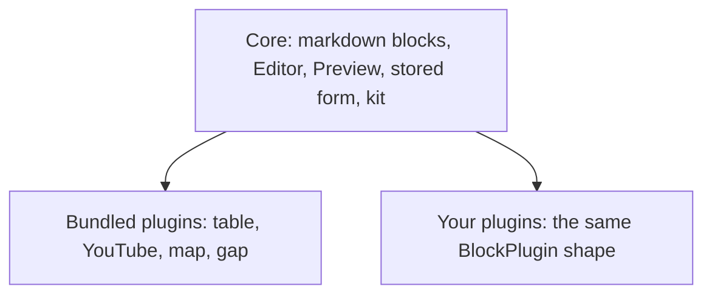

# Block editing with @atom-forge/brickee

`@atom-forge/brickee` is a block editor for Svelte 5. Its core is a markdown block editor — paragraphs, headings, lists, to-dos, quotes, code, dividers — and every other block is a **plugin**: a block with an editor view, a site preview, its fields, and optionally a markdown form. Documents are stored as JSON.

The package is built in three layers:

- **Core** — the markdown blocks, the `Editor` and the `Preview`, the stored form and its markdown conversions, and the **kit** plugins are written with. Without plugins it is a plain markdown block editor.
- **Bundled plugins** — plugins like any other, written only with what the core exports. You opt in to the ones you need.
- **Your plugins** — the same `BlockPlugin` shape, living in your application.

The editor itself knows nothing about your application. Whatever an app needs — its page widths, its code languages, its language — reaches the plugins through **contexts** (view, code languages, text) or through plugin **fields**, never through special editor props. Images are no exception: an image block is a plugin of your own, which stores, picks and resolves its images the way your application does.

This book is for Svelte 5 developers who embed the editor in an application, choose and adapt the bundled plugins, or write their own.

> [!abstract] What you will learn
> How to set up the editor and the preview, what the stored JSON looks like, how markdown comes in and goes out, how to pick, override and extend the bundled plugins, how to write a plugin of your own, how host data reaches the plugins, and how to validate documents on the server.

## Reading path

1. [[getting-started|Getting started]] — the three layers, installation, host setup, and a first editor with its preview.
2. [[editor-and-preview|The editor and the preview]] — the `Editor` and `Preview` props, the palette, the editing features, and scroll sync.
3. [[documents-and-markdown|Documents and markdown]] — the stored form (`StoredBlock`), the built-in blocks, and converting from and to markdown.
4. [[bundled-plugins|Bundled plugins]] — what `@atom-forge/brickee/plugins` contains, and how to override a preview or add fields.
5. [[writing-plugins|Writing plugins]] — the `BlockPlugin` anatomy, fields, views and previews, containers, markdown forms, image blocks, and the kit.
6. [[host-contexts|Host contexts]] — per-view values, code languages, and UI text.
7. [[server-side|On the server]] — schema validation and plain text.
8. [[recipes-and-pitfalls|Recipes and pitfalls]] — complete patterns and the mistakes to avoid.
9. [[upgrading|Upgrading]] — what to change in your code when you move to a newer version.
10. [[ai-notes|AI Notes]] — instructions to copy into the agent instruction file of a project that uses the package.

> [!note] Examples
> Svelte examples are complete components unless they say otherwise. Application values such as the current page width stand for whatever your application provides.
