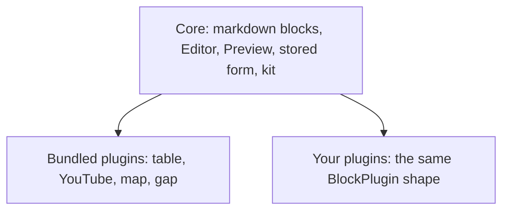

# Brickee

`@atom-forge/brickee` is a block editor for Svelte 5. Its core is a markdown block editor — paragraphs, headings, lists, to-dos, quotes, code, dividers — and every other block is a **plugin**: a block with an editor view, a site preview, its fields, and optionally a markdown form. Documents are stored as JSON.

These pages are derived from the [Brickee book](https://books.atom-forge.eu), which is the source of truth. A Hungarian translation is in [`../hu/index.md`](../hu/index.md); a compact reference for coding agents is in [`README-AI.md`](../../README-AI.md).

The package is built in three layers:

- **Core** (`@atom-forge/brickee`) — the markdown blocks, the `Editor` and the `Preview`, the stored form and its markdown conversions, and the **kit** plugins are written with. Without plugins it is a plain markdown block editor.
- **Bundled plugins** (`@atom-forge/brickee/plugins`) — plugins like any other, written only with what the core exports. You opt in to the ones you need.
- **Your plugins** — the same `BlockPlugin` shape, living in your application.

The editor itself knows nothing about your application. Whatever an app needs — its images, its page widths, its language — reaches the plugins through **contexts** (media, view, text) or through plugin **fields**, never through special editor props.

## Contents

1. [Getting started](getting-started.md) — the three layers, installation, host setup, and a first editor with its preview.
2. [The editor and the preview](editor-and-preview.md) — the `Editor` and `Preview` props, the palette, the editing features, and scroll sync.
3. [Documents and markdown](documents-and-markdown.md) — the stored form (`StoredBlock`), the built-in blocks, and converting from and to markdown.
4. [Bundled plugins](bundled-plugins.md) — what `@atom-forge/brickee/plugins` contains, and how to override a preview or add fields.
5. [Writing plugins](writing-plugins.md) — the `BlockPlugin` anatomy, fields, views and previews, containers, markdown forms, and the kit.
6. [Host contexts](host-contexts.md) — media, per-view values, and UI text.
7. [On the server](server-side.md) — schema validation, plain text, and gated content.
8. [Recipes and pitfalls](recipes-and-pitfalls.md) — complete patterns and the mistakes to avoid.
9. [Upgrading](upgrading.md) — what to change in your code when you move to a newer version.

The book also has an AI Notes chapter: instructions to copy into the agent instruction file of a project that uses the package.

Svelte examples are complete components unless they say otherwise. Application values such as the list of images or the current page width stand for whatever your application provides.
