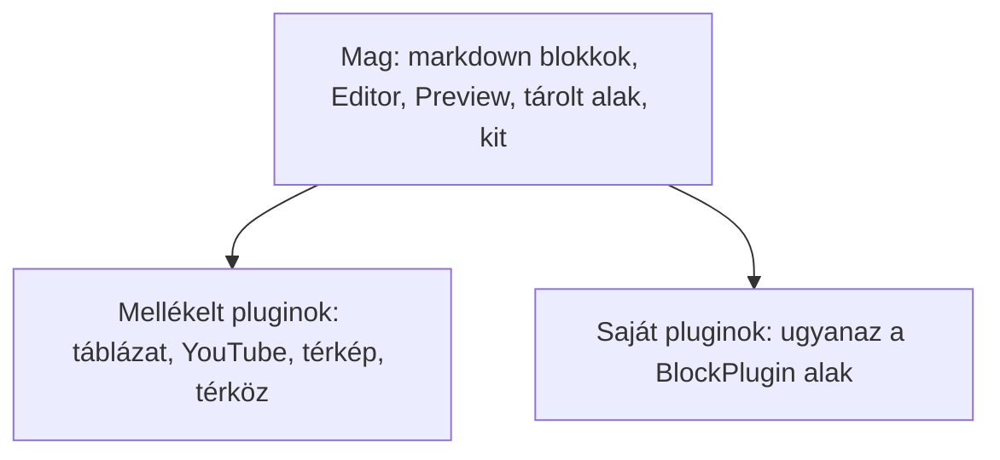

# Brickee

Az `@atom-forge/brickee` blokkszerkesztő Svelte 5-höz. A magja egy markdown blokkszerkesztő — bekezdések, címsorok, listák, teendők, idézetek, kód, elválasztók —, minden más blokk pedig **plugin**: egy blokk, amelynek van szerkesztőnézete, oldali előnézete, vannak mezői, és opcionálisan markdown alakja. A dokumentumok JSON-ként tárolódnak.

Ezek az oldalak a [Brickee könyv](https://books.atom-forge.eu) alapján készültek, és angol nyelvű változatuk, a [`../en/index.md`](../en/index.md) fordításai; eltérés esetén az angol változat a mérvadó. Kódoló ágenseknek tömör referencia a [`README-AI.md`](../../README-AI.md).

A csomag három rétegből épül fel:

- **Mag** (`@atom-forge/brickee`) — a markdown blokkok, az `Editor` és a `Preview`, a tárolt alak és annak markdown-átalakításai, valamint a **kit**, amellyel a pluginok készülnek. Pluginok nélkül egyszerű markdown blokkszerkesztő.
- **Mellékelt pluginok** (`@atom-forge/brickee/plugins`) — ugyanolyan pluginok, mint bármelyik más, és csak abból készültek, amit a mag exportál. Csak azokat kapcsolod be, amelyekre szükséged van.
- **A saját pluginjaid** — ugyanaz a `BlockPlugin` alak, az alkalmazásodban.

Maga a szerkesztő semmit sem tud az alkalmazásodról. A kódnyelvei és a nyelve **kontextusokon** keresztül jutnak el a szerkesztőhöz; minden más — a médiája, az oldalszélességei, a felhasználói — az alkalmazás saját pluginjaira tartozik, amelyek az alkalmazás saját kódjából olvassák, és saját **mezőűrlapot** is mutathatnak. Az alkalmazás fogalmaihoz nincsenek külön szerkesztő-propok.

## Tartalom

1. [Első lépések](getting-started.md) — a három réteg, telepítés, a befogadó alkalmazás beállítása, és egy első szerkesztő az előnézetével.
2. [A szerkesztő és az előnézet](editor-and-preview.md) — az `Editor` és a `Preview` propjai, a paletta, a szerkesztési funkciók és a görgetés-szinkron.
3. [Dokumentumok és markdown](documents-and-markdown.md) — a tárolt alak (`StoredBlock`), a beépített blokkok, valamint az átalakítás markdownból és markdownba.
4. [Mellékelt pluginok](bundled-plugins.md) — mit tartalmaz az `@atom-forge/brickee/plugins`, és hogyan írhatsz felül egy előnézetet vagy adhatsz hozzá mezőket.
5. [Pluginok írása](writing-plugins.md) — a `BlockPlugin` felépítése, mezők és saját mezőűrlapok, nézetek és előnézetek, tárolók, markdown alakok, inline pluginok és a kit.
6. [Az alkalmazás kontextusai](host-contexts.md) — kódnyelvek és felületi szövegek, és honnan jönnek az alkalmazás saját adatai.
7. [A szerveren](server-side.md) — sémavalidálás, sima szöveg.
8. [Receptek és buktatók](recipes-and-pitfalls.md) — teljes minták és az elkerülendő hibák.
9. [Frissítés](upgrading.md) — mit kell módosítanod a kódodban, amikor újabb verzióra váltasz.

A könyvben van egy AI Notes fejezet is: utasítások, amelyeket a csomagot használó projekt ágens-utasításfájljába másolhatsz.

A Svelte-példák teljes komponensek, hacsak másként nem jelzik. Az alkalmazásbeli értékek, például az aktuális oldalszélesség, azt jelölik, amit az alkalmazásod biztosít.
